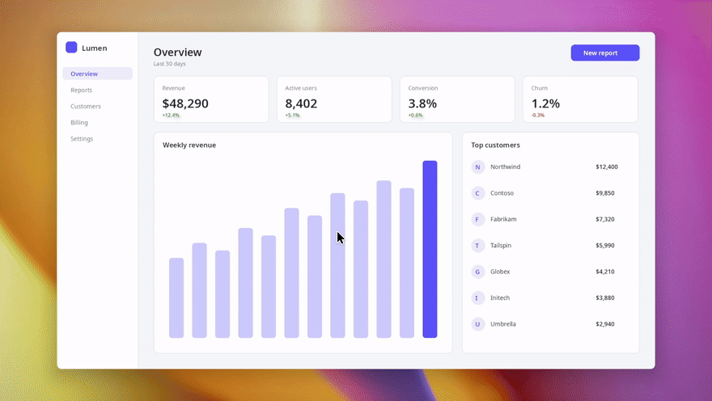
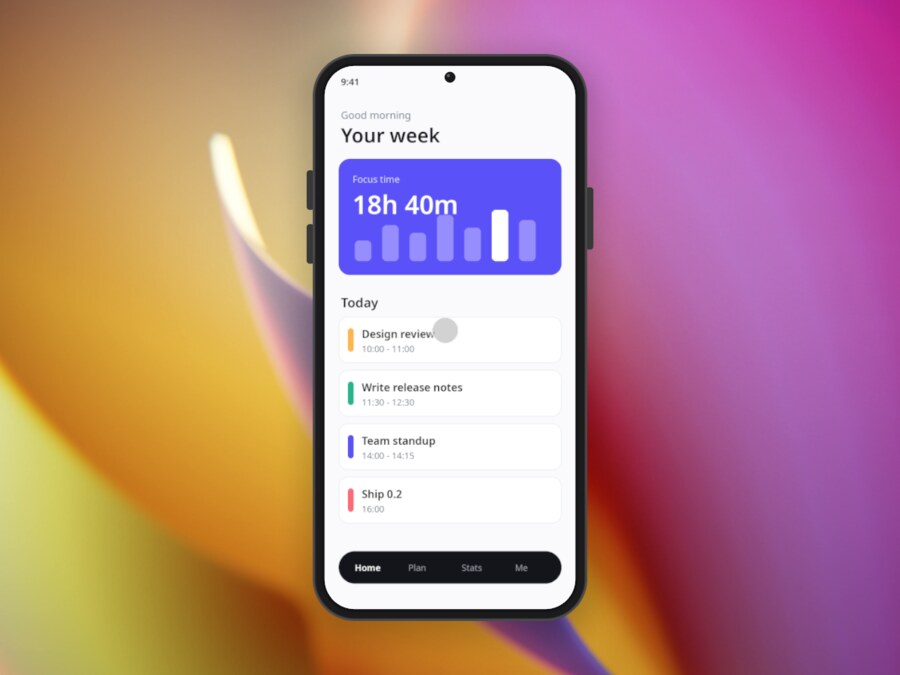
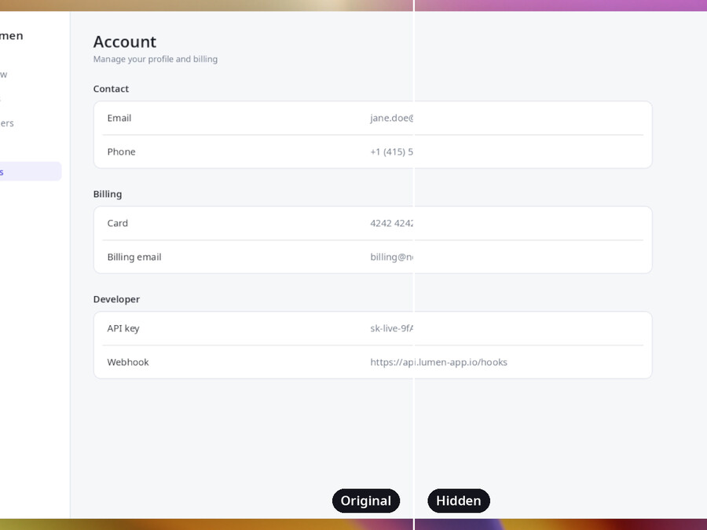
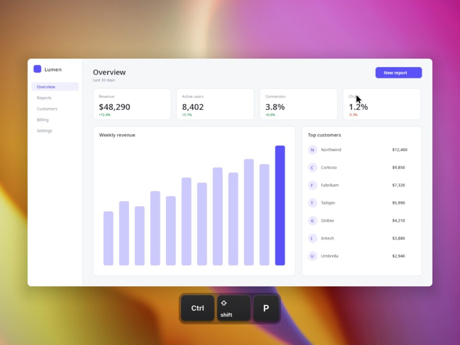

> [!WARNING]
> Open Studio is under active development and experimental. Expect bugs, missing pieces and changes between versions. It has been tested on Hyprland only so far; other desktops should work but are untested.

<div align="center">

# Open Studio

**Polished screen recordings on Linux.**
Automatic zooms, a smooth cursor and a beautiful frame, straight out of the recorder.

[](LICENSE)


[](https://github.com/IHAVENOARMS/open-studio/actions/workflows/ci.yml)



</div>

## Highlights

- **Automatic zoom.** Clicks become zooms that ease in, follow the cursor and ease out. Adjust, split or aim them by hand.
- **A cursor worth watching.** Recorded separately and redrawn sharp at any size, with smoothing, click effects and a touch circle for phones.
- **Styled output.** Wallpapers, gradients, padding, rounded corners, shadows, motion blur and any aspect ratio from 16:9 to 9:16.
- **Camera and audio.** Webcam or phone camera with layouts and background removal. Microphone, system audio and a phone's own sound.
- **Captions.** Local transcription with Whisper. Edit the video by editing its transcript.
- **Privacy.** Emails, phone and card numbers, keys and faces are found and hidden automatically.
- **Phones.** Mirror an Android phone over USB or Wi-Fi and present it in a device frame.
- **Export.** MP4, GIF or ProRes, encoded on the GPU (VAAPI, NVENC) or CPU, to a file or the clipboard, one project or many.

<table>
  <tr>
    <td width="33%"></td>
    <td width="33%"></td>
    <td width="33%"></td>
  </tr>
  <tr>
    <td align="center"><sub><b>Device frames</b><br>Phone recordings, presented</sub></td>
    <td align="center"><sub><b>Hide sensitive data</b><br>Covered automatically, even while scrolling</sub></td>
    <td align="center"><sub><b>Keyboard shortcuts</b><br>Shown as you press them</sub></td>
  </tr>
</table>

## Getting started

### Download

Download the AppImage from the [latest release](https://github.com/IHAVENOARMS/open-studio/releases/latest), make it executable and run it: it brings everything it needs. A smaller tarball that uses your system's libraries is there too.

### Build from source

**Requirements:** Rust (stable), ffmpeg, GStreamer with the base, good and PipeWire plugins, and a Wayland session with xdg-desktop-portal.

```sh
# Arch Linux
sudo pacman -S rust clang ffmpeg gstreamer gst-plugins-base gst-plugins-good gst-plugin-pipewire pipewire

git clone https://github.com/IHAVENOARMS/open-studio
cd open-studio
cargo build --release
./target/release/open-studio
```

Clicks and keys are read from input devices, so add yourself to the `input` group (`sudo usermod -aG input $USER`, then log in again).

**Optional:** `scrcpy` and `adb` for phones, `tesseract` for hiding sensitive data, `whisper-cpp` for captions.

## Usage

Run `open-studio`. On Hyprland it opens the recording bar: pick a display, window, area or phone, and record. On other desktops it opens the projects window, and recording starts from your desktop's screen picker. When you stop, share the video right away or open it in the editor.

| | |
|---|---|
| Stop recording | <kbd>Ctrl</kbd> <kbd>Alt</kbd> <kbd>Enter</kbd> |
| Mark a moment while recording | <kbd>Ctrl</kbd> <kbd>Alt</kbd> <kbd>F</kbd> |
| Command menu | <kbd>Ctrl</kbd> <kbd>K</kbd> |
| All shortcuts | <kbd>Ctrl</kbd> <kbd>/</kbd> |

Everything also works from the command line:

```sh
open-studio record --display DP-1 --mic default
open-studio stop
open-studio export ~/Videos/"Open Studio"/Demo --format mp4 --height 1080
```

## Compatibility

| | |
|---|---|
| **Hyprland** | Tested. Direct capture, cursor and window tracking |
| **Sway, KDE and other compositors with layer-shell** | Supported, not yet tested |
| **GNOME and other Wayland desktops** | Capture and cursor through the screen-sharing portal, not yet tested |
| **Encoding** | CPU and AMD (VAAPI) tested; Intel (VAAPI) and NVIDIA (NVENC) not yet tested |

## Documentation

A project wiki with guides for every feature is on the way.

## License

[GPL-3.0-or-later](LICENSE). Open Studio is an independent project inspired by [Screen Studio](https://screen.studio) and is not affiliated with it.
